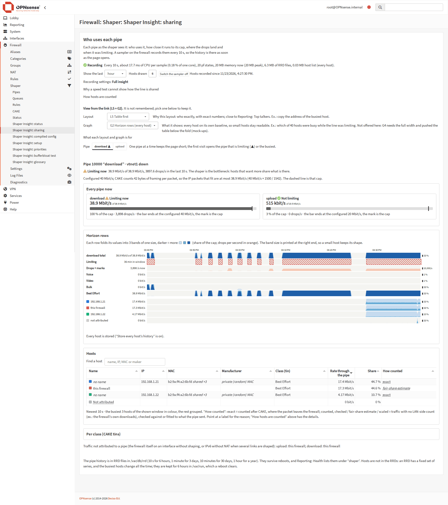
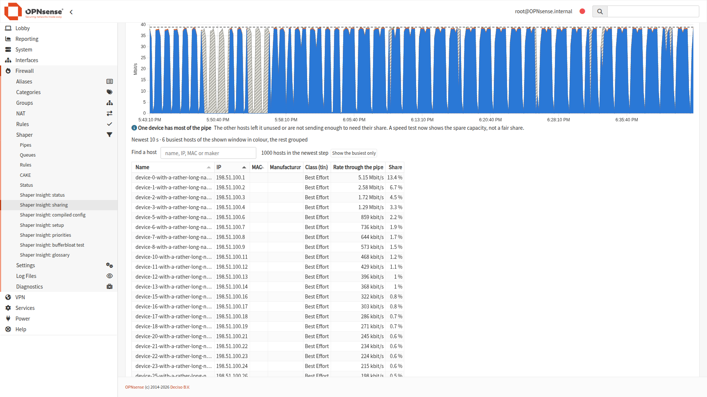
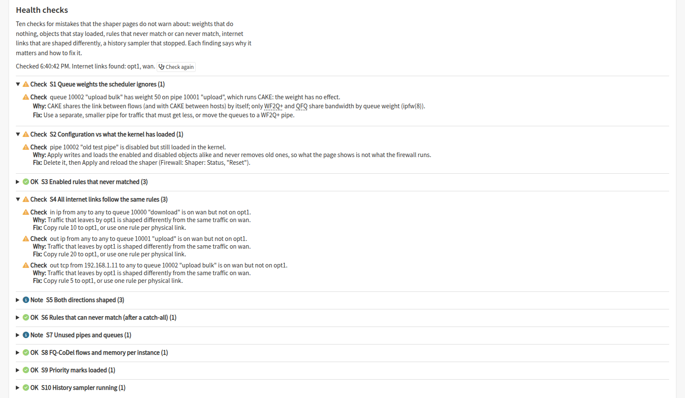
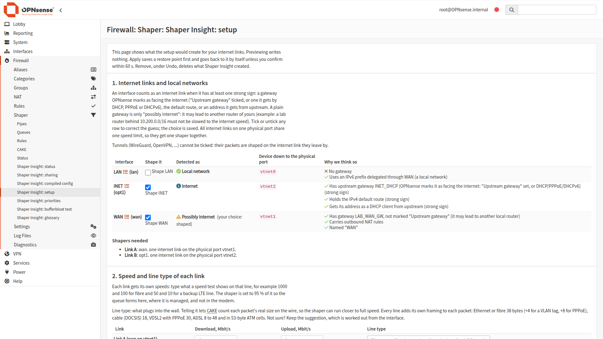
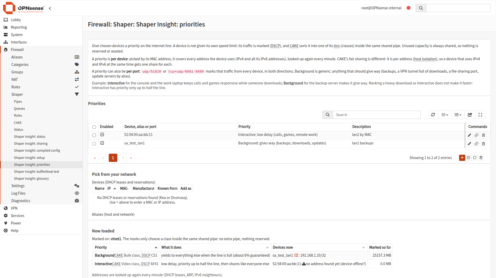
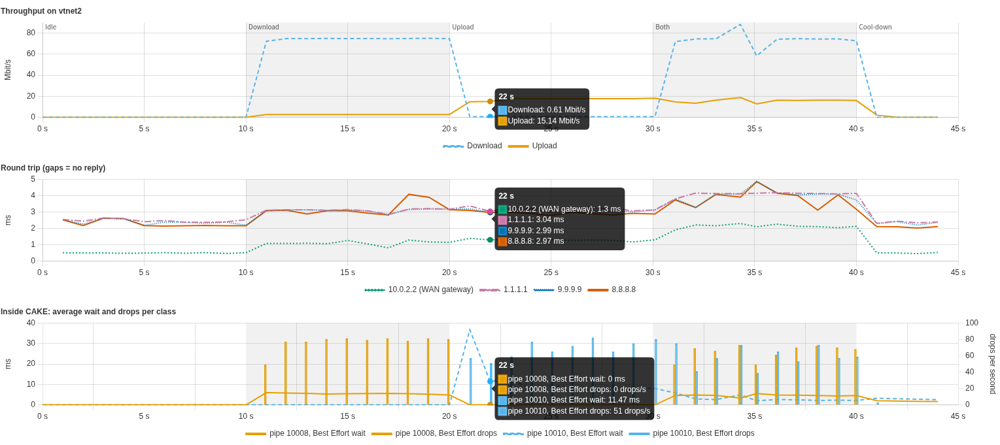
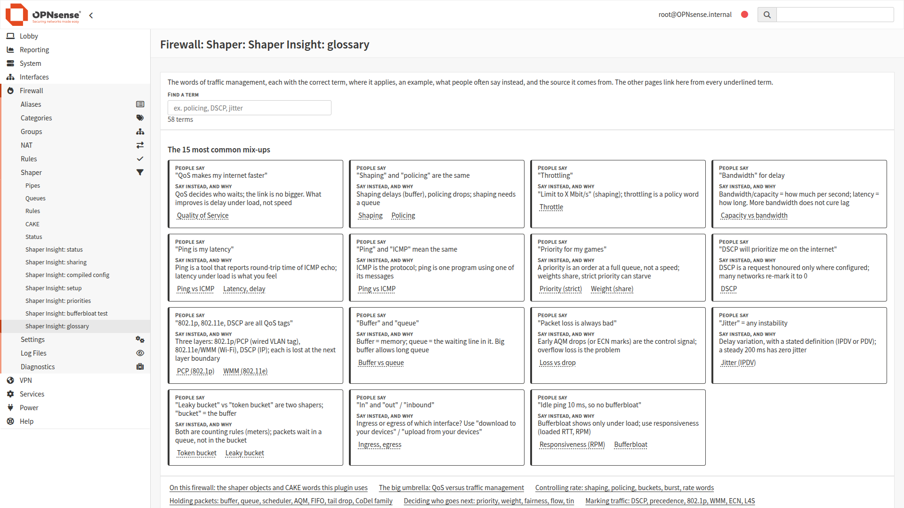
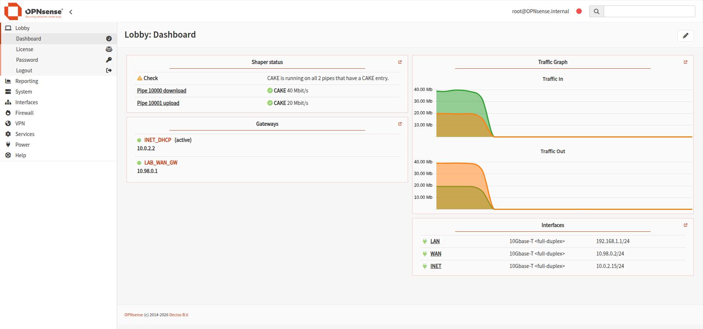
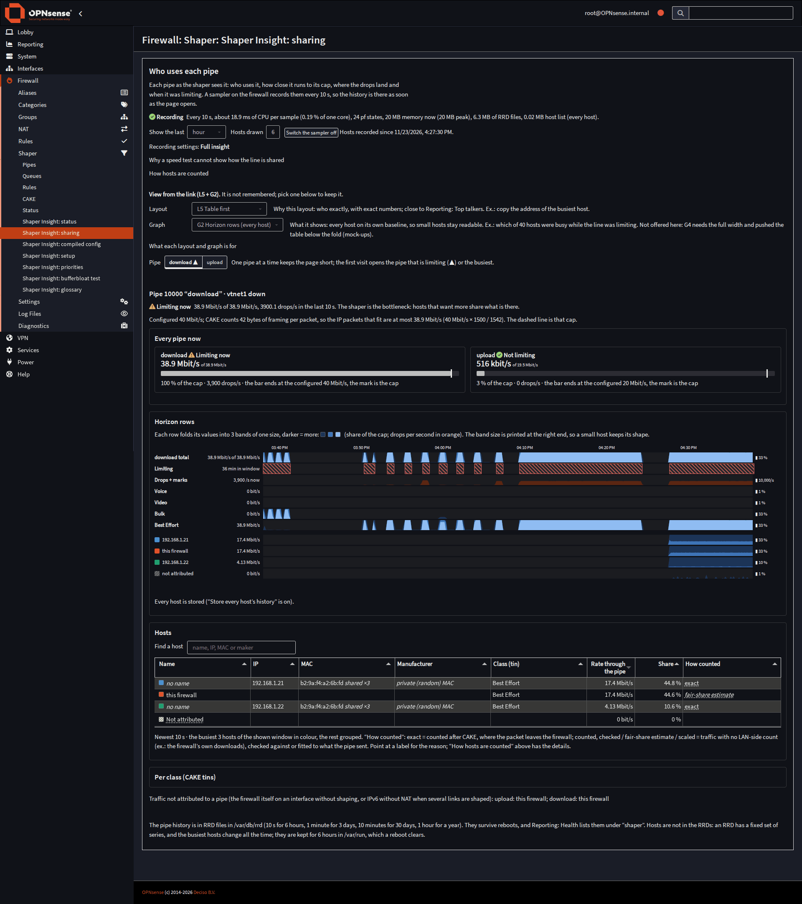
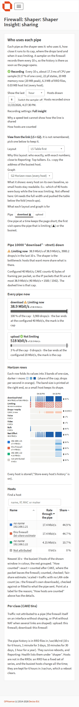

# os-shaper-insight

> **Unofficial proof of concept — not affiliated with OPNsense or os-cake; anyone may fork and take it over.**

A companion plugin for the OPNsense traffic shaper. It **shows** whether the shaper really
does what its configuration says, and it can **set up** a shaper for your internet links
and **undo** that setup. It changes your configuration only when you press Apply, Remove or
a priority Apply, and the sections below list everything each of those writes.

Its pages are under **Firewall › Shaper › Shaper Insight**. It is not related to OPNsense's
**Reporting › Insight** (the NetFlow traffic reports); the name only says that it shows what
the shaper does.

Earlier name: os-shaper-assistant (used only for early test installs until 2026-11-22). See
"Switching from os-shaper-assistant" below.

## Screenshots

All taken on the lab VM (versions 1.0.h to 1.0.k; the addresses are lab and documentation addresses), at
1920x1080 unless noted; tall pages are cropped to their top part.

**Sharing: who uses each pipe.** Each host's rate under the pipe's real payload cap, the
"Limiting now" verdict, drops and ECN marks, the per-class (CAKE tin) view, and how each
host's number was counted. Several layouts and graphs show the same data; this one is the
table first with one row per host. This is the question a single speed test cannot answer: how the line is
shared while several devices want it.



**Sharing with 1,000 hosts.** The chart colours at most 8 hosts and groups the rest; the full
list comes from the server, windowed, with a search box. It shows the page stays usable on a
large network (documentation addresses, fake names).



**Status: health checks.** Ten checks for shaper mistakes the core pages do not warn about,
each with why it matters and how to fix it; here a queue weight CAKE ignores, a disabled pipe
still loaded, and two internet links shaped differently.



**Setup: which links are internet links.** Detection with the reason for every guess
(upstream gateway, default route, DHCP from upstream), so a wrong guess can be seen and
corrected before anything is written.



**Priorities.** Devices, aliases or ports marked for a CAKE class, and what is loaded now with
the bytes marked so far: the proof that a priority is in effect.



**Bufferbloat test result.** Throughput, round trips and CAKE's wait and drops on one time
axis, with a shared crosshair, so a delay spike can be matched to the load that caused it
(lab numbers, not an internet line).



**Glossary.** The terms the pages use, starting with the 15 most common mix-ups (shaping vs
policing, bandwidth vs delay, ping vs ICMP), each with a source. Every underlined term on the
other pages links here.



**Dashboard widget "Shaper status".** Whether CAKE is really running on each pipe, on the
OPNsense dashboard.



**Dark theme** and **phone (390 px wide)**: the same sharing page in OPNsense's dark theme, and
on a phone.





## What it does

What it only reads:

- **Firewall › Shaper › Shaper Insight: status**: for each pipe, the scheduler the kernel is
  really running (CAKE through the [os-cake](https://github.com/pletch/opnsense-cake) plugin,
  or FQ-CoDel), the configuration compared with the kernel, settings the scheduler ignores,
  per-tin CAKE counters and a live graph. Health checks S1-S10: weights that do nothing,
  objects that stay loaded, rules that never match or can never match, internet links shaped
  differently, priority marks that failed to load. With no shaper configured they say so
  instead of reporting "OK".
- **Firewall › Shaper › Shaper Insight: compiled config**: the generated dnctl input, the input
  after os-cake's rewrite, the loaded ipfw rules (the shaper's and Shaper Insight's own
  priority marks) and kernel objects, CAKE counters and versions, as text for a forum post.
  Public addresses, MAC addresses, host names and the descriptions you typed are hidden by
  default.
- **Firewall › Shaper › Shaper Insight: sharing** ("Who uses each pipe"): per pipe, the rate of
  every local host stacked under the pipe's payload cap (the configured rate × 1500 / (1500 +
  CAKE overhead): 840 Mbit/s with 42 bytes carries at most ~817 Mbit/s of IP packets), an
  "Idle / Limiting now" badge (limiting = at 90 % of the cap or more in 2 of the last 3 steps,
  or at least 1 drop/s while at half the cap or more), CAKE drops, ECN marks and average wait,
  and with diffserv the rate per CAKE tin with the Bulk threshold (1/16 of the rate) and whether
  Background traffic is using the free line, sharing or yielding. It explains why a single speed test cannot show
  sharing. Five layouts and five graphs of the same data, picked on the page. Download per host is
  counted after CAKE (from the LAN-side pf state); a "How counted" column says when a number is an
  estimate instead. Windows from 10 minutes to a year. Full privilege only: it lists local addresses.
- **History sampler** (on by default; the sharing page switches it off): every 10 s it reads
  the CAKE counters (`sysctl`), the shaper rule counters (`ipfw show`) and the pf states
  (`pfctl -vss`, for the per-host rates; pre-NAT addresses credit upload to the LAN host). Each
  sample is stamped at the read. Pipes and tins go into RRD files next to core's own in
  `/var/db/rrd` (`pipeN-shaper.rrd`, `pipeN-tins-shaper.rrd`; 10 s for 6 hours, 1 minute for 3
  days, 10 minutes for 30 days, 1 hour for a year; about 1.9 + 1.3 MB per CAKE pipe with four
  tins), which survive reboots; Reporting › Health lists them under "shaper". Hosts are kept for
  6 hours in `/var/run/shaperinsight/hosts.jsonl` (every host, up to 2,000 per pipe and step, or the top 16
  with "Store every host's history" off; the page colours 3 to 8 of them, setting "Hosts drawn", 8 by default, and groups the rest), not in RRDs: an RRD
  has a fixed set of series and the busiest hosts keep changing. It runs as a service
  (`daemon(8)`, System › Diagnostics › Services lists it), starts at boot and on install, and
  stops on uninstall; its RRD files stay, like core's. Cost, measured on a 4-core lab VM: idle
  about 15 ms of CPU a sample and 18 MB; 22 000 states about 230 ms and 46 MB with the per-host
  read every 30 s; above 50 000 states the per-host view pauses and memory is given back once
  they drop. The sharing page shows the current cost and suggests an insight level (Full or Light,
  `docs/INSIGHT-LEVELS.md`); a cron job (`sampler.ensure`, every 5
  minutes) restarts a sampler that stopped while switched on, and health check S10 reports it.
- **Tables**: every table sorts (click or Enter on a header), host tables show Name, IP, MAC and
  Manufacturer (from core's IEEE list, as the ARP page does; no lookups leave the firewall), and
  alias, pipe, queue and interface names link to their page in core with the content on hover.
- **Glossary** and a **dashboard widget** "Shaper status".

What it changes, and only when you press the button:

- **Setup: Apply** writes pipes, queues and shaper rules (marked with origin
  `ShaperInsight`) and, with os-cake, CAKE entries (named `[Insight] ...`). It first
  shows the exact plan; Apply writes that plan or nothing (if the configuration changed
  since the preview, it asks you to preview again). If one of **your** rules already shapes
  a link, you choose: skip that link, or **"Disable mine"**, which switches your rule off
  (not deleted; Remove switches it back on). A restore point of the shaper and CAKE sections
  is saved first, and a 60 s timer puts it back unless you confirm, also after a reboot. If
  the apply job stops before you confirm and the shaper settings were changed since, it
  does not put anything back by itself: the setup page asks you which to keep.
- **Setup: Remove** (section "Undo") deletes exactly the objects recorded when you confirmed
  an apply, and switches back on the rules it had disabled (only those still off). A
  Shaper Insight object that something of yours still uses (a queue or rule you pointed at a
  Shaper Insight pipe) is kept and listed.
- **Priorities: Apply** loads ipfw rules (set 7, numbers 2000-2099) and two tables that set a
  DSCP mark, so CAKE sorts chosen devices into a class. A priority is per device: picked by MAC
  address it covers all of the device's IPv4 and IPv6 addresses (containers on ipvlan share their
  host's MAC: the page warns when one MAC has several IPv4 addresses). An address, network or
  host/network alias works too, and so does a protocol and port (`udp/51820`, `tcp+udp/6881-6889`),
  which marks that traffic from every device, both directions, the port on either end. Background
  is generic deprioritisation, for anything that should give way. While a priority is enabled,
  cron refreshes the tables every minute.
- **Bufferbloat test** downloads and uploads to third-party servers for about 45 s per run
  (defaults: Cloudflare's speed test and ping targets 1.1.1.1 and 9.9.9.9; the page names
  them and you can change them or set a rate cap). It sends roughly your line rate times the
  test time in each direction.

CAKE's fair sharing is per address, not per device: each address gets a fair share (usually
one per device), and a device using IPv4 and IPv6 at the same time, or several IPv6 privacy
addresses, counts once per address (measured in the lab: 66.5 % of the line instead of 50 %).
The status page lists local devices that recently used several addresses.

os-cake is optional and is detected at runtime. Without it the plan uses FQ-CoDel, which
shares the line fairly between connections but not between devices, and priorities have no
effect.

How it was tested, with the results: `TESTING.md`.

## Install a release package

Each [release](https://github.com/luuvasara/os-shaper-insight/releases) carries the package
built from that tag and its SHA-256. The package is not signed; check the hash. Built for
OPNsense 26.7 (amd64).

```sh
fetch https://github.com/luuvasara/os-shaper-insight/releases/download/v2026.11.23a/os-shaper-insight-devel-2026.11.23a.pkg
sha256 -q os-shaper-insight-devel-2026.11.23a.pkg   # compare with SHA256SUMS on the release page
pkg add os-shaper-insight-devel-2026.11.23a.pkg
```

Updates are manual: install the next release's package the same way. Versions after 1.0.i are dated
(year.month.day plus a letter, e.g. 2026.11.23a) and sort after the 1.0.x ones. Removal: see "Remove".

## Install for testing (from source)

These are the exact steps used on the development VM (OPNsense 26.7.9_3, amd64). They build
a package from this source tree inside an opnsense/plugins checkout; nothing is downloaded
from this project's side.

1. On the firewall, as root, install git and fetch the plugins tree:

   ```sh
   pkg install -y git
   git clone --depth 1 https://github.com/opnsense/plugins.git /usr/plugins
   ```

2. Copy this repository's `net/shaper-insight` directory to the firewall, for example
   from a checkout of this repository on your computer (replace `firewall` with its
   address):

   ```sh
   tar -C net -cf - shaper-insight | ssh root@firewall 'tar -C /usr/plugins/net -xf -'
   ssh root@firewall 'chmod -R go-w /usr/plugins/net/shaper-insight'
   ```

   The package keeps the files' modes, and the scripts in it run as root; the `chmod` makes sure
   no file is group- or world-writable, whatever umask the checkout was made under.

3. Build, install and register it:

   ```sh
   cd /usr/plugins/net/shaper-insight
   make upgrade
   /usr/local/opnsense/scripts/firmware/register.php install os-shaper-insight-devel
   ```

   `make upgrade` builds the package `os-shaper-insight-devel` (a plugin built from a
   plugins checkout carries the `-devel` suffix) and installs it; the package scripts restart
   configd and flush the menu and ACL caches. `register.php` records the plugin the way
   System › Firmware › Plugins does; without it that page lists it as "misconfigured".

   What installing changes: two configuration revisions, both from OPNsense itself (the
   settings section every plugin with a model gets, and `register.php`). Nothing in the
   shaper, and nothing in the kernel while no priority is set: no ipfw reload (which would zero
   every rule counter), no ipfw tables, no ipfw set touched. With priorities set (a
   reinstall), it reloads ipfw once to load their marks.

4. Open **Firewall › Shaper › Shaper Insight: status**.

## Remove

**To take Shaper Insight's shaping away, press Remove (setup page, "Undo") before
uninstalling.** Uninstalling alone leaves your shaper as it is: as with every OPNsense plugin,
the configuration stays. The pipes, queues, rules and CAKE entries keep working; only the
priorities turn off, because their marks need the plugin. A reinstall picks the setup up again
(and loads the marks), and Remove still works then.

```sh
pkg delete -y os-shaper-insight-devel
/usr/local/opnsense/scripts/firmware/register.php remove os-shaper-insight-devel
```

The order is the one OPNsense's own plugin removal uses (`scripts/firmware/remove.sh`: `pkg
remove`, then `register.php remove`): `register.php remove` only unregisters a plugin whose files
are already gone, so run before `pkg delete` it does nothing and the plugin stays listed in
System: Firmware until the next reboot.

If the uninstall step fails while an apply may still be waiting for its confirmation, the
package script stops the removal (removing the scripts then would leave that change in place for
good); confirm or wait for the apply, then uninstall again. `SHAPERINSIGHT_FORCE_REMOVE=1 pkg
delete -y os-shaper-insight-devel` removes it anyway.

What the uninstall script does: it ends a pending confirm countdown by putting the restore
point back (that change was never confirmed; if an apply is still running after two minutes it
stops the uninstall instead), stops a running bufferbloat test, unloads the priority rules
(ipfw set 7) and tables, deletes its runtime files under `/var/run` and its compiled Python
files, and rebuilds cron if it still has the priority job. It does not reload ipfw (that would
zero every rule counter); core's own rule script is used from the next reload on. It keeps `OPNsense/ShaperInsight` in config.xml,
the record of what Shaper Insight created and the restore points (`/conf/shaperinsight-*.json`)
and the bufferbloat results (`/var/db/shaperinsight`).

Updating a source build: `make upgrade` in the plugins tree is `pkg delete` + `pkg add`, so it
runs the same uninstall and install scripts; your setup and priorities are the same afterwards.
A pending countdown is reverted by it.

### Optional: os-cake

The CAKE parts need os-cake (tested with os-cake 1.4.15 and cake-kmod 1.5.15). Its README
describes the signed package repository (recommended) and the release files; the release
files are on [its releases page](https://github.com/pletch/opnsense-cake/releases). The
development VM used the files of release v1.5.15:

```sh
cd /tmp
fetch https://github.com/pletch/opnsense-cake/releases/download/v1.5.15/cake-kmod-1.5.15.pkg
fetch https://github.com/pletch/opnsense-cake/releases/download/v1.5.15/dummynet-st-1.0.15.pkg
fetch https://github.com/pletch/opnsense-cake/releases/download/v1.5.15/os-cake-1.4.15.pkg
fetch https://github.com/pletch/opnsense-cake/releases/download/v1.5.15/SHA256SUMS
sha256sum -c SHA256SUMS
pkg add cake-kmod-1.5.15.pkg
pkg add dummynet-st-1.0.15.pkg
pkg add os-cake-1.4.15.pkg
/usr/local/opnsense/scripts/firmware/register.php install os-cake
```

`sha256sum -c` must say OK for the three packages. `SHA256SUMS.sig` on the same release
signs `SHA256SUMS`; os-cake's SECURITY.md explains how to check it with the key in its
repository.

## Switching from os-shaper-assistant

The plugin was called os-shaper-assistant before 2026-11-22. Both packages install the same
`/usr/local/etc/rc.conf.d/ipfw`, so pkg refuses to have both; remove the old one first:

```sh
pkg delete -y os-shaper-assistant-devel
/usr/local/opnsense/scripts/firmware/register.php remove os-shaper-assistant-devel
# then install os-shaper-insight as in "Install for testing" (make upgrade + register.php install)
```

On install, os-shaper-insight moves what the old plugin left, once, and logs each step in the
system log (`shaperinsight: migration: ...`) and on the console:
- `/conf/shaperassistant-{apply,sections,ledger,applied}.json` become
  `/conf/shaperinsight-*.json` (only where the new name has no file yet), and the state's
  restore-point path is updated; `/var/db/shaperassistant` (bufferbloat results) becomes
  `/var/db/shaperinsight`;
- the settings section `OPNsense/ShaperAssistant` (page settings, priorities, saved link
  ticks and speeds) is copied into `OPNsense/ShaperInsight` and then deleted, which is what
  makes the migration run once. This is one configuration revision. If a value does not
  validate, nothing is copied, the old section stays, and the log says why.

Nothing in the shaper is changed. Pipes, queues, rules and CAKE entries the old plugin made
(origin `ShaperAssistant`, names `Assistant ...` / `[Assistant] ...`) are still treated as the
plugin's own: Remove takes them (they are in the moved ledger), and the next Apply changes them
in place to the new names. If Apply was never used with the old plugin (no objects), there is nothing
to move but the settings section.

## Development and tests

It runs in production on the author's own gateway. Development and the tests of every write path
were done on a throw-away OPNsense VM on a Linux host, with its own network namespaces and bridges and iperf3
endpoints for test traffic. The lab scripts are not part of
this repository because they encode the test host's setup; `TESTING.md` describes the methods
and results without them. `tools/shots/` takes the screenshots and runs axe-core (`npm install`
there first; it uses the system Chrome).

Tests: `python3 -m unittest discover -s tests`. File modes: `tools/check_modes.py --tree net/shaper-insight`
before a build and `tools/check_modes.py PKG` after it (fails on group- or world-writable files). Claim ids: `tools/claims/build.py --check`
checks that every "Why?" link the UI shows has an entry in `claims.json`, which carries the
sources (URL and verbatim quote) itself. The fuller claims registry it was built from is not
published; `--check` needs nothing else.

## How this was made

Most of the code and text was written with the help of frontier AI, directed and reviewed by
the author, tested on the lab VM and run in production as described in `TESTING.md`. Read it
as a proof of concept: check what it does on a test firewall before you use it on one you
depend on.

## Security and contributing

See `SECURITY.md` for how to report a vulnerability and `CONTRIBUTING.md` for changes.

## Licence

BSD 2-Clause, as opnsense/plugins. See `LICENSE`.
